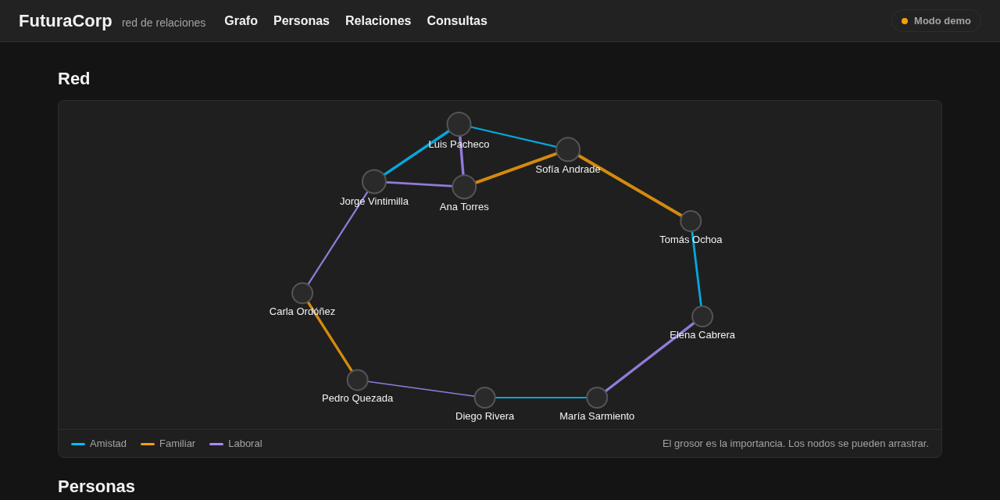
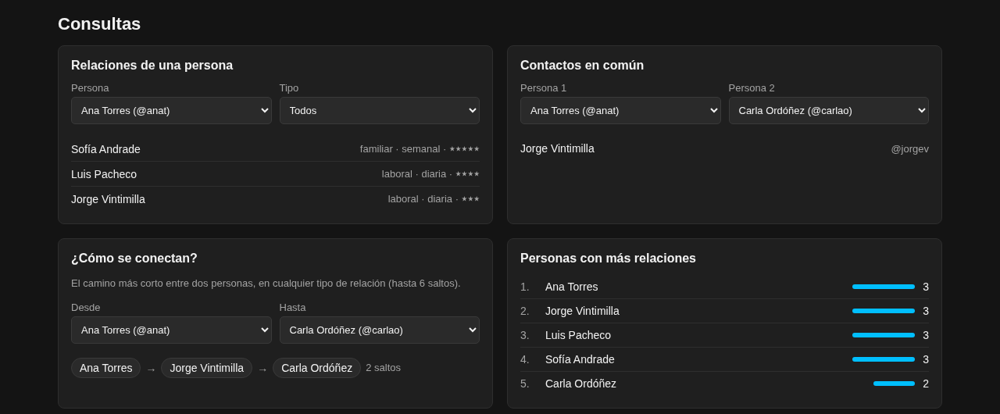

# neo4j-red-de-relaciones

[](https://github.com/Whiteherobot/neo4j-red-de-relaciones/actions/workflows/ci.yml)

Registro de personas y de las relaciones entre ellas (amistad, familiar,
laboral) sobre la base de grafos Neo4j, con consultas propias de un grafo:
contactos en común, el camino más corto entre dos personas y las más
conectadas. Proyecto de la materia de Bases de Datos (febrero de 2025), hecho
en pareja, para la empresa ficticia FuturaCorp.

**Demo:** https://whiteherobot.github.io/neo4j-red-de-relaciones/ (modo demo,
con los datos guardados en tu navegador).





## Cómo funciona

La página es HTML, CSS y JavaScript sin compilación (módulos ES). Trabaja
sobre un *almacén* con dos implementaciones con la misma interfaz:

- **Modo demo** (`js/almacen-memoria.js`): el grafo vive en el navegador y se
  guarda en `localStorage`. Es lo que se ve en GitHub Pages.
- **Neo4j** (`js/almacen-neo4j.js`): usa el driver oficial y el esquema del
  proyecto original, `(:Person)-[:RELATIONSHIP {type, frequency, importance}]->(:Person)`.
  Crea una restricción de unicidad para el nickname, borra con `DETACH DELETE`
  y resuelve el camino con `shortestPath`. Las relaciones se guardan con una
  dirección, pero se consultan en las dos.

La vista del grafo es un canvas con un layout de fuerzas (Fruchterman-Reingold)
escrito a mano: el color de cada arista es el tipo de relación y el grosor, la
importancia.

## Usarlo con Neo4j

```bash
docker compose up -d              # Neo4j 5 en localhost:7687 (clave redrelaciones2026)
npm install && npm run semilla    # carga los datos de ejemplo
python3 -m http.server 8000       # y abrir http://localhost:8000
```

En la página, el botón de conexión pide la URL, el usuario y la contraseña
(no se guardan). Tiene que abrirse desde `http://localhost`: una página
servida por https no puede conectarse a `bolt://`.

## Pruebas

```bash
npm test                                   # modelo y almacén en memoria
NEO4J_URL=bolt://localhost:7687 npm test   # además, las mismas pruebas contra Neo4j
```

`test/contrato.js` tiene las pruebas que deben pasar los dos almacenes:
duplicados (también al revés), relaciones en ambas direcciones, contactos en
común, ranking, camino más corto y borrado en cascada. En GitHub Actions corren
contra un Neo4j levantado como servicio.

## De dónde sale

En 2025 la página registraba personas y relaciones con consultas Cypher desde
el navegador, pero el archivo que abría la conexión (`database.js`, con la
clave en el código) quedó fuera del repo por el `.gitignore`, así que la
versión publicada no funcionaba. Además, borrar a una persona con relaciones
fallaba, las relaciones se buscaban por nombre (que se puede repetir) y la
lista de personas reemplazaba a su propia tabla.

En 2026 se rehízo conservando el esquema y las consultas: la conexión se pide
en la interfaz, se agregó el modo demo para que funcione publicado, la vista
del grafo, el camino más corto y las pruebas. El repo se llamaba
`Whiteherobot.github.io`.

## Autores

- Michael Lata ([@Whiteherobot](https://github.com/Whiteherobot))
- [@SirYorch](https://github.com/SirYorch)

Licencia MIT.
